<!-- BANNER -->
<p align="center">
  
</p>

<!-- TYPING ANIMATION -->
<p align="center">
  
</p>

<p align="center">
  <a href="https://github.com/nesyass"></a>
  <a href="mailto:sasanesya08@gmail.com"></a>
</p>

---

## `whoami`

```bash
nesya@cybersec:~$ whoami

Name       : nesya
Role       : Cybersecurity Enthusiast
Focus      : Red Team | Blue Team | GRC
Currently  : Learning & Building
Motto      : Explore. Detect. Defend.
```

## `cat /etc/interests`

<table>
  <tr>
    <td width="50%" valign="top">
      <h3>🔴 Red Team</h3>
      <ul>
        <li>Reconnaissance</li>
        <li>Penetration Testing</li>
        <li>Vulnerability Assessment</li>
        <li>Web Application Security</li>
      </ul>
    </td>
    <td width="50%" valign="top">
      <h3>🔵 Blue Team</h3>
      <ul>
        <li>Security Monitoring</li>
        <li>Threat Detection</li>
        <li>Log Analysis</li>
        <li>Incident Response</li>
      </ul>
    </td>
  </tr>
</table>

## `ls tech-stack/`

**Languages & Development**

<p>
  
</p>

**Security Tools**

<p>
  
  
  
  
  
</p>

**Frameworks & Standards**

<p>
  
  
  
</p>

---

## `./github-analytics.sh`

<p align="center">
  
</p>

## `./contribution-snake.sh`

<p align="center">
  <picture>
    <source media="(prefers-color-scheme: dark)" srcset="https://raw.githubusercontent.com/nesyass/nesyass/output/github-contribution-grid-snake-dark.svg">
    <source media="(prefers-color-scheme: light)" srcset="https://raw.githubusercontent.com/nesyass/nesyass/output/github-contribution-grid-snake.svg">
    
  </picture>
</p>

---

<p align="center">
  <b>“Explore. Detect. Defend. Repeat.”</b>
</p>

<p align="center">
  <a href="https://github.com/nesyass">GitHub</a> ·
  <a href="mailto:sasanesya08@gmail.com">Email</a>
</p>
