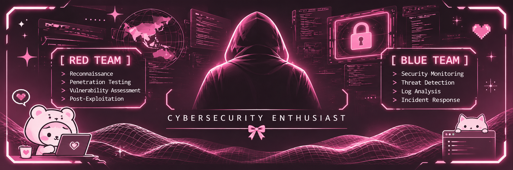

<!-- ================= BANNER ================= -->

  

<!-- ================= ANIMATED INTRO ================= -->

  

  
  

---

## `whoami`

<table width="100%">
  <tr>
    <td width="56%" valign="top">
      
<b>Cybersecurity Enthusiast</b> interested in understanding how systems can be attacked, monitored, and defended.

      
I enjoy exploring vulnerabilities, analyzing security findings, and turning technical observations into clear, actionable recommendations.

      
<b>Current interests</b>

      <ul>
        <li>Web application security and VAPT</li>
        <li>Security monitoring and threat detection</li>
        <li>Security engineering, GRC, and security frameworks</li>
      </ul>
    </td>
    <td width="44%" valign="top">
      <pre>
nesya@cybersec:~$ whoami

Name      : Nesya
Role      : Cybersecurity Enthusiast
Focus     : Red Team | Blue Team | GRC
Approach  : Learn • Test • Analyze
Status    : Learning & Building
      </pre>
    </td>
  </tr>
</table>

---

## `cat /etc/mission-areas`

<table align="center" width="100%">
  <tr>
    <td width="50%" align="center" valign="top">
      <h2>🔴 RED TEAM</h2>
      
<b>OFFENSIVE SECURITY</b>

      

      

      

      

    </td>
    <td width="50%" align="center" valign="top">
      <h2>🔵 BLUE TEAM</h2>
      
<b>DEFENSIVE SECURITY</b>

      

      

      

      

    </td>
  </tr>
</table>

  

---

## `ls tech-stack/`

<h3 align="center">Languages & Development</h3>

  

<h3 align="center">Security & Infrastructure</h3>

  

  
  
  
  
  

<h3 align="center">Frameworks & Standards</h3>

  
  
  

---

## `./security-workflow.sh`

<table width="100%">
  <tr>
    <td align="center" width="20%">
      <h3>01</h3>
      <b>DISCOVER</b>
      
Map the attack surface and gather context.

    </td>
    <td align="center" width="20%">
      <h3>02</h3>
      <b>ASSESS</b>
      
Identify and validate potential weaknesses.

    </td>
    <td align="center" width="20%">
      <h3>03</h3>
      <b>ANALYZE</b>
      
Understand impact, likelihood, and evidence.

    </td>
    <td align="center" width="20%">
      <h3>04</h3>
      <b>REPORT</b>
      
Communicate risks and practical fixes.

    </td>
    <td align="center" width="20%">
      <h3>05</h3>
      <b>IMPROVE</b>
      
Retest and strengthen security posture.

    </td>
  </tr>
</table>

<i>Security testing is performed only on systems with proper authorization.</i>

---

## `./contribution-snake.sh`

  <picture>
    <source media="(prefers-color-scheme: dark)" srcset="https://raw.githubusercontent.com/nesyass/nesyass/output/github-contribution-grid-snake-dark.svg"/>
    <source media="(prefers-color-scheme: light)" srcset="https://raw.githubusercontent.com/nesyass/nesyass/output/github-contribution-grid-snake.svg"/>
    
  </picture>

---

  

  <a href="https://github.com/nesyass">GITHUB</a> &nbsp; // &nbsp;
  <a href="mailto:sasanesya08@gmail.com">EMAIL</a>

